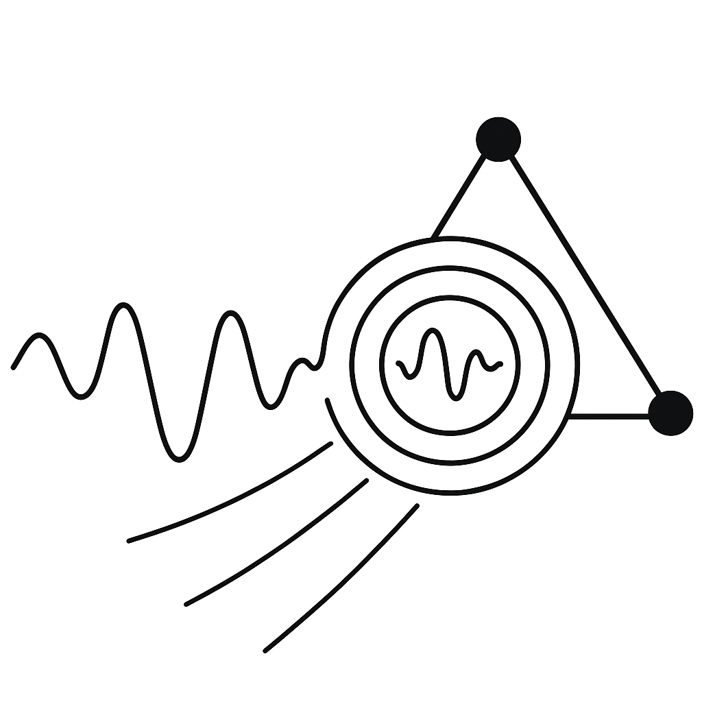

WDM_LISAresponse documentation
==============================

Authors: Tomasz Kinowski & Christopher J. Moore

A fast, JAX-based Python implementation for computing LISA detector response functions
using the Wilson-Daubechies-Meyer (WDM) wavelet framework.

The project lives on `GitHub <https://github.com/cjm96/WDM_LISAresponse>`_.

.. toctree::
   :maxdepth: 5
   :caption: Mathematical Background:

   theory
   response_functions

.. toctree::
   :maxdepth: 7
   :caption: Package Contents:

   modules
   examples

.. toctree::
   :maxdepth: 5
   :caption: Code Repository:

   GitHub
